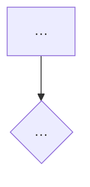

# Flow & Lo-fi Author

**Sheerline area 5 (Wireframing & Prototyping) · P3 deepen · buildable-now, self-application-first · build class N.** A designer has a task or a flow to shape and a question the shaping must answer: is the three-step checkout right, can a first-time user find the export. Before any visual language is applied, this skill does the structural work: it enumerates the screens, draws the flow, and drafts **N structurally distinct** skeletons so the room has real alternatives to look at instead of the first one that rendered. It stops at the point where a human must say **whether the flow is right** and **which alternative advances**. Those are direction calls.

**Why it exists.** `OPERATING_PRINCIPLES.md` § Design and visual work protocol already binds every visual build to IA → lo-fi → hi-fi and says hi-fi "does not begin until the lo-fi is validated." Until this skill, no skill served that phase: every `ui-studio` routing row resolves to a hi-fi builder. This skill is the instrument under the rule.

**The boundary this skill obeys (Sheerline, absolute).** A structured artifact with explicit empty judgment slots, a named human gate, and provenance labels on anything inferred. *The structure / flow verdict and which alternative advances are the empty slots.* Enumerating screens, drawing the flow, drafting alternatives, tagging them on the divergence axes, and stripping anything over the fidelity ceiling are mechanical; judging the flow and choosing the direction are the human's. A version of this skill that ranks the alternatives, recommends one, or lets a hex, a font, or a token into a skeleton has exceeded its charter. The ideation-diversity guard (`sheerline/os/operating-principles.md` § The zero-cost operating invariants) is pointed at here, not restated: this skill widens.

> **This skill closes through the Exit Gate (`CLAUDE-SESSION-RULES.md § Exit Gate`).** See the bottom-of-skill bracket.

---

## Routing — disambiguation with sibling skills

| If the task is… | Use |
|---|---|
| "Wireframe this / draft the screen inventory and flow / give me lo-fi alternatives before we go hi-fi" | **this skill** |
| Build the page or component in Mode A, production-ready against a design system | `ui-studio` (client / speculative) · `heyhi-ui-ux` (HeyHi pages). Downstream: a validated alternative becomes the structure they implement |
| Draw or render a flow that is already decided, in FigJam | `heyhi-figjam-mapper` (the seam is a hand-off: this skill's flow map is the Mermaid `flowchart` it renders unchanged) |
| Audit a built prototype for interaction completeness or readiness | `heyhi-prototype-audit` (downstream of hi-fi) |
| Visual direction, a moodboard, divergent visual boards | `heyhi-style-selection` now; `heyhi-visual-exploration` (area 6, candidate) when built — visual divergence is not structural divergence |
| Card sort, tree test, taxonomy, an IA study | area 2 (D-3-gated, 2026-10-09); until then structure inputs are what the human brings and inferred structure is tagged |
| "Are we converging too early / is this too hi-fi for the question" on existing artifacts | `divergence-guard` (this skill generates; that one reads) |
| The states' behavior or copy for a screen | `interaction-inventory` (area 4) · `microcopy-states-writer` (area 3); this skill carries state *names* as placeholders only |
| Whether the flow is right; which alternative advances | **the human** (this skill's named gate) |

---

## Step 0: Improvement hook check

Retrieve any recurring corrections for lo-fi / flow / structure work (`retrieve_design_corrections`, or the Sheerline `os/corrections/` registry). Fold a match into the pass. No lo-fi category exists yet, so this normally finds nothing; skip silently. The hook is wired from day one so `insight-activation` can file the first one.

## Step 1: Load context

1. **What the human brought.** The **purpose / test question** is required: what this lo-fi must let the team learn or decide. If it is absent, **ask and stop**; never draft on a guessed purpose (a lo-fi without a question is the fixation path). The task or job the flow serves, in the human's words, is required too. Structure inputs (an IA outline, a sitemap, an existing flow, research synthesis, a PRD, a prototype to restructure) are optional: proceed without them, and tag every screen or edge the skill supplies `[inferred]`. N is optional (default 3; minimum 2; the human may set any N).
2. `sheerline/os/foundations/prototyping/FOUNDATION.md` — the area-5 governed context. Register under it; do not author it.
3. `references/lofi-method.md` — the fidelity ceiling table, the divergence axes (authored once, here; `divergence-guard` points at them), the screen-inventory schema, and the Mermaid hand-off rule. THE method spine.
4. `references/worked-example.md` — a filled Lo-fi Pack on invented input. Read it to calibrate register and depth; do not copy its content.
5. The engagement-intake resolution (`sheerline/profile/engagement-intake.yaml`, passed by path), when one exists: `deliverable.root` / `classification` (where the pack lands), `boundary.hermetic_seal_confirmed` (no client name on the artifact), `constraints.brand_voice_source` for **label register only** (lo-fi labels are functional, marked `[provisional]`, never copy). Absent a profile, the instance's own defaults apply.
6. **`active-brand.json` is never opened.** Not "not required": never read. Reading a brand config is the first step toward a token, and a token is over the ceiling. The `ui-studio` no-config hard stop does not apply here; the ceiling is the config.

## Step 2: Draft, mechanically

Each step below is mechanical. None of it judges the flow, ranks an alternative, or writes final copy.

1. **Screen inventory.** Enumerate every screen or state-surface the task touches: id, name, one-line purpose, entry points, exits, the data it needs, and a **state-placeholder list** (loading · empty · error · success, as *names only*; their behavior is `interaction-inventory`'s, their copy `microcopy-states-writer`'s). Provenance per row: `[from-input]` or `[inferred]`.
2. **Flow map.** The task as nodes and edges, emitted as a **Mermaid `flowchart`** in the constraints `heyhi-figjam-mapper` renders through `generate_diagram` (camelCase ids, quoted special characters, no emojis or HTML). Decision nodes, error paths, and dead ends named. Any edge the skill supplies to connect the structure is `[inferred]`; a missing step is a **gap to flag**, never a node to fill silently.
3. **N alternatives, structurally distinct.** For each alternative: a name, its **divergence-axis tags** (navigation model · task decomposition · information hierarchy · entry point · disclosure strategy · input model; `lofi-method.md` § 2), and a skeleton: per screen, the regions in reading order, the primary action, the secondary actions, the content blocks as labeled boxes, and the interaction logic between regions. Grayscale, unstyled, no imagery, no type or color choice. Labels are functional or marked `[provisional]`. (A monochrome HTML skeleton is a v1.1 option behind a flag, not a v1 step.)
4. **Overlap check.** Compare every pair of alternatives on the axes. A pair that shares **every** tag is a rearrangement, not an alternative: say so, and regenerate or ask, rather than ship a fake N. This is the measurable half of the invariant's widen and measure verbs.
5. **Fidelity-ceiling self-check.** Before emitting, sweep every skeleton for anything over the ceiling (`lofi-method.md` § 1): a hex, a font name, a token reference, an image, a brand-config value, a motion spec, a component *selection* from a design system. Anything found is removed and listed under `## Ceiling violations removed`, so a reviewer sees what tried to get in.
6. **Provenance and gaps.** Every inferred item carries `[inferred]`; every gap in the inputs is a named question under `## Open questions`, never a filled-in guess.

## Step 3: Produce the Lo-fi Pack

Output this exact structure. The two ⛔ slots and the gate are present by construction.

````
# Lo-fi Pack — [task / flow name]
Purpose (the test question): [as stated by the human]     Drafted: [date]
Fidelity: LO-FI (ceiling: structure, layout, placement, interaction logic; no visual language)
Config: none (brand-agnostic by design)

## Screen inventory
| id | Screen | Purpose | Entry from | Exits to | Data needed | State placeholders | Provenance |
|----|--------|---------|------------|----------|-------------|--------------------|------------|
| S1 | …      | …       | …          | …        | …           | loading · empty · error | [from-input] / [inferred] |

## Flow map (Mermaid flowchart — hand to heyhi-figjam-mapper to render unchanged)

Inferred edges: [list, each tagged]   Gaps flagged (not filled): [list]

## Alternatives (N = [n]; each structurally distinct on ≥ 1 axis)
### A — [name]   axes: nav=… · decomposition=… · hierarchy=… · entry=… · disclosure=… · input=…
[per-screen skeleton: regions in reading order · primary action · secondary actions ·
 content blocks as labeled boxes · interaction logic · labels marked [provisional]]
### B — …   axes: …
### C — …   axes: …
Overlap check: A/B share [axes]; A/C share […]; B/C share […]. No pair shares every axis.

## Ceiling violations removed
[anything over the ceiling that was stripped before emit — a hex, a font, a token, an image]

## Open questions (questions, not guesses)
- …

## ⛔ Structure / flow verdict — NEEDS HUMAN
Is the flow right? Is a screen missing? Does the decomposition match the work?  ____________
## ⛔ Which alternative advances — NEEDS HUMAN
Advancing to hi-fi: ____________   (the skill ranks nothing)

## Named gate
Design lead / product owner: ____________   Date: ______
Nothing advances to hi-fi until this line is signed (OPERATING_PRINCIPLES § Design and visual work protocol).
````

**The pack is done when** the purpose is stated (not guessed), every inventory row carries provenance and a state-placeholder list, the flow map is valid Mermaid `flowchart` with inferred edges tagged and gaps flagged, N alternatives each carry axis tags with no pair sharing every axis, the ceiling sweep ran and its removals are listed, and both ⛔ slots and the gate are blank.

## Step 4: Pre-flight verification

Confirm: the purpose was stated by the human (the skill did not draft on a guess); `active-brand.json` was not opened; no hex, font name, token reference, image, brand value, motion spec, or component selection survives in any skeleton, and anything stripped is listed under `## Ceiling violations removed`; N ≥ 2 and no pair of alternatives shares every axis tag (a rearrangement was named, not shipped); every inferred screen or edge carries `[inferred]` and every input gap is a question; the flow map is Mermaid `flowchart`; no alternative is ranked, scored, or recommended anywhere in the pack; both ⛔ slots and the gate are empty; labels follow the engagement's register when a profile names one, and no client name appears when `hermetic_seal_confirmed` is true.

---

## What is explicitly out of scope

- **The structure / flow verdict and which alternative advances.** Empty by construction. "Which of these is better" returns the ⛔ slot and the gate, never a ranking.
- **Anything over the fidelity ceiling.** Color, type, imagery, tokens, motion, component selection: the hi-fi builders' (`ui-studio`, `heyhi-ui-ux`), after the gate is signed.
- **Drawing the flow in FigJam.** `heyhi-figjam-mapper` renders the pack's Mermaid unchanged.
- **The states' behavior and copy.** `interaction-inventory` (area 4) and `microcopy-states-writer` (area 3); the pack carries state names only.
- **Reading existing artifacts for convergence or fidelity.** `divergence-guard`.
- **Auditing a built prototype.** `heyhi-prototype-audit` / `heyhi-prototype-verify`.
- **The HTML skeleton path.** v1.1, behind a flag (spec § 10 D3), not this version.

---

## Exit Gate Required Headers (bottom-of-skill bracket)

This skill closes through Exit Gate Flavor A (`CLAUDE-SESSION-RULES.md § Exit Gate`). Before declaring done, confirm every required header holds real content:

- `## Fixes Applied` (or the delivered Lo-fi Pack)
- `## Smoke Test` (the Step 4 pre-flight checks, pasted)
- `## Next Session Prompt`

If either ⛔ slot is filled, an alternative is ranked, a fake N shipped, or anything over the ceiling survives, the gate has **not** been satisfied.

---

*HeyHi Confidential. Sheerline area 5 (Wireframing & Prototyping), P3 deepen, build class N. Staged 2026-09-05 (v0.1.0) in `skill-updates/`, registry-inert until the Bucket B convergence pass promotes it and applies the routing override. Spec source: `plans/plan-sheerline-p3-prototyping-lofi-2026-09-05.md` § 2 / § 5 / § 6 / § 9. Foundation: `sheerline/os/foundations/prototyping/FOUNDATION.md`. Boundary: `sheerline/os/operating-principles.md`. The lo-fi definition is inherited from `OPERATING_PRINCIPLES.md` § Design and visual work protocol.*
