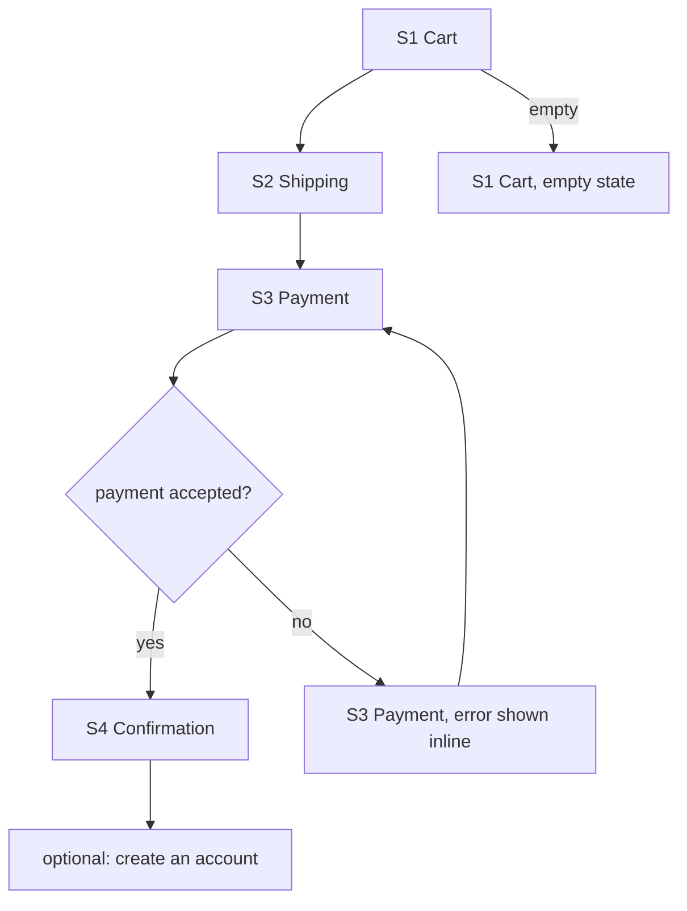

# Worked example — a filled Lo-fi Pack

**Synthetic input, invented product. No client content.** Read this to calibrate the register and depth of the free-prose slots; do not copy its content. The two ⛔ slots are shown empty on purpose, and the gate is unsigned: that is the output shape, not an omission. Notice what is absent: no color, no typeface, no token, no recommendation.

**Synthetic input brought by the (invented) team, verbatim:** *"Purpose: is a three-step guest checkout the right shape for a first-time buyer, or are we forcing steps? Task: buy one item as a guest in our plant-shop app, Fieldnote Market. N = 3. We have a rough IA: Cart → Shipping → Payment → Confirmation. Use our brand green for the pay button."*

---

````
# Lo-fi Pack — Guest checkout (Fieldnote Market, synthetic)
Purpose (the test question): is a three-step guest checkout the right shape for a first-time buyer, or are we forcing steps?     Drafted: 2026-09-05
Fidelity: LO-FI (ceiling: structure, layout, placement, interaction logic; no visual language)
Config: none (brand-agnostic by design)

## Screen inventory
| id | Screen | Purpose | Entry from | Exits to | Data needed | State placeholders | Provenance |
|----|--------|---------|------------|----------|-------------|--------------------|------------|
| S1 | Cart | confirm what is being bought and the total | product page · header cart | S2 · continue shopping | line items, totals | loading · empty · error | [from-input] |
| S2 | Shipping | where it goes and how fast | S1 | S3 · back to S1 | address, delivery options | loading · error | [from-input] |
| S3 | Payment | pay | S2 | S4 · back to S2 | payment method, billing address | loading · error | [from-input] |
| S4 | Confirmation | what was bought, when it arrives, what to do next | S3 | account creation (optional) · continue shopping | order summary | loading · success | [from-input] |
| S5 | Review before pay | see everything once before committing | S2 or S3 | S3 · back | the whole order | error | [inferred] (only alternative C uses it; not in the IA) |

## Flow map (Mermaid flowchart — hand to heyhi-figjam-mapper to render unchanged)

Inferred edges: `ok -- no --> payErr` [inferred] (the IA names no failure path); `conf --> acct` [inferred] (an account step is implied by "guest", not stated).   Gaps flagged (not filled): Is there an order-lookup path for a guest who never creates an account? Where does a promo code enter?

## Alternatives (N = 3; each structurally distinct on ≥ 1 axis)
### A — Three steps, one at a time   axes: nav=linear/wizard · decomposition=stepped · hierarchy=the action · entry=a list (the cart) · disclosure=progressive · input=form
S1 Cart: regions top-down: [line items] [totals] [primary action: continue to shipping] [secondary: continue shopping].
S2 Shipping: [address form] [delivery options as a selection] [primary action: continue to payment] [secondary: back].
S3 Payment: [payment method selection] [billing address, defaults to shipping, override on demand] [primary action: pay [provisional]] [secondary: back].
S4 Confirmation: [order summary] [arrival estimate] [secondary: create an account] [secondary: continue shopping].
Interaction logic: one primary action per screen advances; back never loses entered data.

### B — One page, everything visible   axes: nav=single-page with disclosure · decomposition=one screen · hierarchy=the object (the order) · entry=a list (the cart) · disclosure=everything visible · input=form
S1+S2+S3 collapsed into one scrollable screen: [line items + totals, pinned] [shipping block] [payment block] [primary action: pay [provisional], at the end]. Each block validates inline; the primary action stays inert until every block is complete (state name: disabled).
S4 Confirmation as in A.
Interaction logic: editing any block re-validates only that block; the pinned totals update on delivery-option change.

### C — Two steps and a review   axes: nav=linear/wizard · decomposition=split by object (details, then money) · hierarchy=the choice (the review) · entry=a list (the cart) · disclosure=defaults-first with override · input=selection from candidates
S1 Cart: as in A.
S2 Shipping + Payment on one screen: [saved or default delivery option, override on demand] [saved or default payment method, override on demand] [primary action: review order].
S5 Review before pay: [everything, read-only, each block with an edit affordance] [primary action: pay [provisional]] [secondary: back].
S4 Confirmation as in A.
Interaction logic: the review is the only place the commit happens; every edit affordance returns to S2 with the block expanded.

Overlap check: A/B share entry and input; A/C share nav and entry; B/C share entry. No pair shares every axis.

## Ceiling violations removed
- "brand green for the pay button" — a color; the pay button is a labeled primary action in every alternative, uncolored.

## Open questions (questions, not guesses)
- Is there an order-lookup path for a guest who never creates an account?
- Where does a promo code enter, and does it change the step count?
- Does "first-time buyer" mean no saved address or payment? (Alternative C assumes defaults may exist; if not, its "defaults-first" axis collapses toward A.)

## ⛔ Structure / flow verdict — NEEDS HUMAN
Is the flow right? Is a screen missing? Does the decomposition match the work?  ____________
## ⛔ Which alternative advances — NEEDS HUMAN
Advancing to hi-fi: ____________   (the skill ranks nothing)

## Named gate
Design lead / product owner: ____________   Date: ______
Nothing advances to hi-fi until this line is signed (OPERATING_PRINCIPLES § Design and visual work protocol).
````

**What to notice.** The brand green went to `## Ceiling violations removed`, not onto the button. S5 is `[inferred]` because only one alternative needs it and the IA never named it; the promo-code question was not answered by inventing a screen. The three alternatives differ on decomposition and disclosure, not on where the boxes sit, and the overlap check says which axes each pair shares. Nothing says which alternative is better, and the pay label is `[provisional]` because copy is not this skill's.

*HeyHi Confidential. Worked example for `flow-and-lofi-author` (synthetic). Spec source: `plans/plan-sheerline-p3-prototyping-lofi-2026-09-05.md` § 6.2.*
