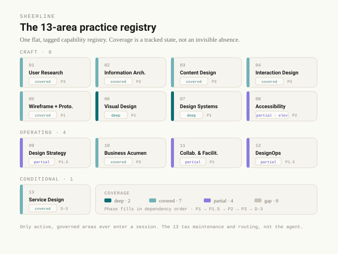

# Architecture

Six figures. Read them in order the first time; after that, each one stands alone.

Sheerline is a **keel instance**, so the first two figures place it in that lineage and show the layer model it inherits. The next four are Sheerline's own: the practice registry, the quality loop that is its most-built module, the boundary that protects the moat, and the shape of a single design session. Each figure carries its own caveat in the footer rather than overclaiming, and each renders in light and dark.

The one frame to hold while reading: **keel is the firm-of-one harness; Sheerline is the same idea aimed at design output.** Four verbs run through it: retrieve the system, validate against it, grade the result over time, learn from correction.

## 1. Where Sheerline sits

A hull has two defining longitudinal lines. keel is the structural line below the waterline; sheer is the beautiful visible line above it. That is the whole naming logic, and it carries a discipline: three things stay separate. keel is the general harness. Sheerline is the whole design-practice OS. The Design-Systems quality loop is one module of Sheerline, its most-built one, not the whole thing.

Conflating the module with the harness is the trap this OS exists to avoid.

Detail: [`../README.md`](../README.md)

## 2. The three layers, instantiated for design

Sheerline rents the same runtime, owns the same configuration, and extends the same deployment layer keel does. The one structural difference is the slot keel has no room for: `os/foundations/<practice-area>/`, per-area governed design context that loads only when the session type calls for it. The foundations reference HeyHi's existing corpus in place; they never byte-copy it.

The line between owned and rented is the one worth knowing, because it is the line a change of agent tool has to respect.

Detail: [`three-layer-model.md`](../../releases/open-source/keel/docs/three-layer-model.md) (keel), and [`../README.md`](../README.md) (Sheerline's own layers and the net-new foundations slot)

## 3. The 13-area practice registry

HeyHi's design capability is deep but lopsided: strong in Visual and Design Systems, thin upstream. Governance turns that into a *tracked state* rather than an invisible absence. Every area carries a coverage tag and a phase, so a gap is a thing you can see and schedule, not a silence.

Only active, governed areas ever enter a session. The thirteen tax maintenance and routing, not the agent.

Detail: [`../os/foundations/registry.yaml`](../os/foundations/registry.yaml)

## 4. The Design-Systems quality loop

This is the module that is built. **Retrieve** the system through the MCP tools, never paste it. **Validate** the emitted output against the system with deterministic, zero-token checks. **Grade** it over time: a linter emits a boolean, an evaluator emits a series. **Learn** from correction: one registry feeds four readers, and a factual correction injects while a behavioral one only reminds a human.

Grades inform, never gate. A score routes a human decision; it never auto-approves taste or auto-blocks a merge.

Detail: the module's own five-figure walkthrough, [`design-system-mcp/docs/architecture.md`](../../releases/open-source/design-system-mcp/docs/architecture.md), and [`../os/foundations/design-systems/FOUNDATION.md`](../os/foundations/design-systems/FOUNDATION.md). That public walkthrough documents the abstracted, published scaffold (one resource, four tools); the live internal subsystem drawn here adds the fundamentals resource and the corrections tool, so its counts run ahead of the public doc.

## 5. The boundary and the retained moat

The fourth invariant is load-bearing here: the MCP, the evaluator, and the corrections registry are reached *through the MCP as a boundary tool*, nested and referenced, never embedded. That boundary is also where the value is protected. The scaffold is potentially publishable; the populated instance (the calibrated evaluator, the corpus, the promotion judgment) stays in a separate unpublished tree.

The conflict order is two-axis on purpose: you author on the brand axis and grade on the severity axis, which is why the brand system can rank high for what to emit and low for what to grade first. Both are true at once.

Detail: [`../os/operating-principles.md`](../os/operating-principles.md)

## 6. How a design task runs

Scope it, route it to one skill, load only what fits, run the loop, then do the thing source inspection cannot do: render it and look. The design smoke test is the standing form of "grades inform, the human reads": you view the rendered surface, not the source, and test one specific observation against the system's intent.

Close through the same gate every time, and capture the correction so it loads before the mistake can happen again.

Detail: [`../os/session-rules.md`](../os/session-rules.md)

## Using these figures

Each file is a self-contained SVG with no external dependencies. Colors live in a `<style>` block with a `prefers-color-scheme` override, so a figure follows the reader's theme where the renderer supports it and falls back to the light palette where it does not. Type falls back cleanly where Sora, Lora, and DM Mono are not available.

The palette is Sheerline's, shared across the set: **indigo** for what keel gives you (the owned configuration), **teal** for what Sheerline adds (the foundations, the design surface), **crimson** for the load-bearing line (the ownership seam, the moat wall, the "grades inform, never gate" rule), and neutral for what is rented or commodity.

These figures, and the tree they describe, are **HeyHi Confidential**. They document the scaffold as architecture; the calibrated content behind the moat wall in figure 5 is never drawn here.

**Rendered orientation.** A self-contained page, [`governed-loop.html`](governed-loop.html) (regenerate with [`governed-loop.build.py`](governed-loop.build.py)), embeds these six figures and carries the governed loop through to its application in a client engagement's prototype skill. Open it in a browser for the narrated walk-through.

---

*Frame and naming: [`../README.md`](../README.md) · Constraints: [`../os/operating-principles.md`](../os/operating-principles.md) · Session workflow: [`../os/session-rules.md`](../os/session-rules.md)*

*HeyHi Confidential*
